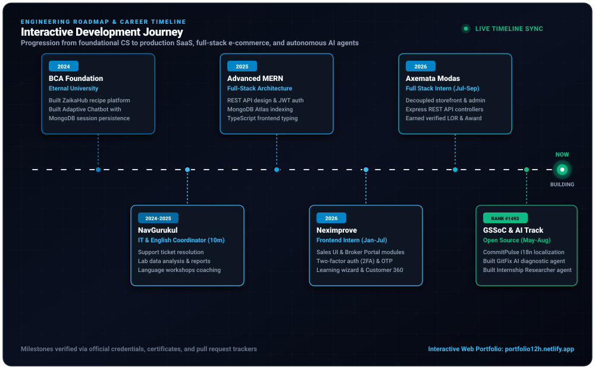

  

  
  &nbsp;
  
  &nbsp;
  
  &nbsp;
  
  &nbsp;
  

  <a href="#about-me">About</a> &bull;
  <a href="#technology-stack">Tech Stack</a> &bull;
  <a href="#featured-projects">Featured Projects</a> &bull;
  <a href="#experience--open-source">Experience</a> &bull;
  <a href="#github-analytics">GitHub Analytics</a> &bull;
  <a href="#certifications--achievements">Certifications</a> &bull;
  <a href="#get-in-touch">Contact</a>

---

## About Me

I am a third-year Bachelor of Computer Applications (BCA) student at Eternal University, building scalable full-stack web applications and exploring AI-powered tools and autonomous agents.

My practical experience includes engineering responsive SaaS portal modules and authentication systems at **Neximprove**, developing decoupled full-stack e-commerce architectures at **Axemata Modas**, and contributing to global open source in **GirlScript Summer of Code 2026 (Global Rank #1,493)**. I focus on creating clean, reusable frontend architectures, resilient RESTful APIs, and practical developer automation tools.

- **Current Academic Status:** BCA Candidate (2025&ndash;2027), Eternal University
- **Location:** Assam, India
- **Core Focus:** React.js, Next.js, Node.js, Express.js, TypeScript, MongoDB, and AI Agents
- **Target Roles:** Full Stack Developer, Software Engineer, and AI/ML Developer internships and associate positions

---

## Technology Stack

### Frontend

  
  
  
  
  
  
  

### Backend

  
  
  
  
  

### Databases & Cloud

  
  
  

### Tools & DevOps

  
  
  
  
  

### AI & Emerging Technologies

  
  
  

---

## Featured Projects

### 1. GitFix &mdash; AI Git &amp; GitHub Diagnostic Assistant
> **Developer Tool &bull; AI Agent &bull; Debugging Automation**

- **Problem:** Developers often encounter cryptic Git errors (merge conflicts, detached HEAD states, rebase issues) where running incorrect commands can cause irreversible loss of committed work.
- **Solution:** An AI agent that analyzes raw terminal error logs, identifies root causes in plain language, and generates step-by-step resolution commands with explicit warnings before potentially destructive operations.
- **Technologies:** Smartly Labs, AI Agent Architecture, Developer Tooling, Git CLI Diagnostics
- **Links:** [Launch Live Agent](https://infra.smartlylabs.ai/agents/cmt7498fv00030ai20hy3qwzg/chat)

---

### 2. Internship Researcher &mdash; Automated Career Intelligence Agent
> **Career Automation &bull; Web Scraping &bull; AI Research**

- **Problem:** Finding legitimate, active internship openings across disparate job boards and corporate portals is time-consuming and often surfaced with outdated deadlines.
- **Solution:** An autonomous research agent built on Smartly Labs that searches official career portals by field, role, and location preferences, extracting verified eligibility criteria, compensation/stipend details, application deadlines, and direct apply links.
- **Technologies:** Smartly Labs, AI Agent Workflows, Automation, Structured Web Research
- **Links:** [Launch Live Agent](https://infra.smartlylabs.ai/agents/cmsn2q2je000z04lhwzl2q7ai/chat)

---

### 3. Resume Analyzer &mdash; AI Career Evaluation Platform
> **Career Platform &bull; ATS Optimization &bull; Frontend Analytics**

- **Problem:** Job applicants frequently struggle to identify ATS formatting discrepancies and keyword misalignments before submitting resumes to enterprise applicant tracking systems.
- **Solution:** A React-based document evaluation platform that evaluates resume structure, computes scoring metrics, and provides actionable keyword matching recommendations through an interactive preview dashboard.
- **Technologies:** React.js, Tailwind CSS, REST APIs, Vercel
- **Links:** [Live Demo](https://ai-career-platform-delta.vercel.app/) &bull; [Source Code](https://github.com/24-Harshdeep/ai-career-platform)

---

### 4. ZaikaHub &mdash; Recipe Discovery Web Platform
> **Web Application &bull; REST API Integration &bull; Responsive Design**

- **Problem:** Users need a fast, intuitive way to search, filter, and explore curated culinary recipes without heavy page reloads.
- **Solution:** A responsive culinary exploration platform built with React and Tailwind CSS, featuring client-side dynamic routing via React Router, external API data fetching, and an adaptive multi-device layout.
- **Technologies:** React.js, React Router, REST APIs, Tailwind CSS, Netlify
- **Links:** [Live Demo](https://zaikahubb.netlify.app/) &bull; [Source Code](https://github.com/24-Harshdeep/Zaikahub)

---

### 5. Adaptive Chatbot &mdash; Full-Stack Conversational AI
> **Full-Stack Application &bull; Session Persistence &bull; Backend Routing**

- **Problem:** Lightweight chat interfaces frequently fail to persist conversation context across page reloads or maintain structured user interaction records.
- **Solution:** A full-stack conversational web application featuring custom Express.js REST API routes, real-time message state rendering in React, and persistent MongoDB document models for session and message history tracking.
- **Technologies:** React.js, Node.js, Express.js, MongoDB Atlas, REST APIs
- **Links:** [Live Demo](https://chatbot-frontend-3f4it92se-24-harshdeeps-projects.vercel.app/) &bull; [Source Code](https://github.com/24-Harshdeep/ChatBot-FullStack-)

---

## Experience &amp; Open Source

| Role | Organization | Timeline | Core Focus | Verification |
| :--- | :--- | :--- | :--- | :--- |
| **Frontend Developer Intern** | Neximprove Private Limited | Jan 2026 &ndash; Jul 2026 | React.js, TypeScript, 2FA, SaaS Portals | [Certificate](https://drive.google.com/file/d/1573CNFDEyrAhnZKRcAMIuUUnu0Fe5pDC/view?usp=sharing) |
| **Full Stack Developer Intern** | Axemata Modas | Jul 2026 &ndash; Sep 2026 | Next.js, Express, MongoDB, E-Commerce | [Certificate](https://drive.google.com/file/d/1IpNHrhQm-cHrD1kcxBwhyVuk2jRDoYPz/view) &bull; [LOR](https://drive.google.com/file/d/1F40hMleezsCwpPg2zc0Ae49j_nJuwvFE/view) |
| **Open Source Contributor** | GirlScript Summer of Code | May 2026 &ndash; Aug 2026 | Rank #1,493, CommitPulse i18n &amp; UI | [Certificate](https://drive.google.com/file/d/1PX5a8u1xOJLLbQO5ICWpXVuAKQU4QzNh/view?usp=sharing) &bull; [Profile](https://gssoc.girlscript.org/profile/6cfd5893-9684-4568-869b-b2583dac461f) |
| **AI Developer Contributor** | Smartly Labs (GSSoC AI) | Jul 2026 &ndash; Aug 2026 | GitFix &amp; Internship Researcher AI | [Certificate](https://drive.google.com/file/d/1jkHj33mH-d1dcBB1dMoGk3-CHQRBSnZt/view?usp=sharing) &bull; [Profile](https://infra.smartlylabs.ai/profile) |
| **IT Facilitator &amp; English Coordinator** | NavGurukul / Eternal University | Nov 2024 &ndash; Aug 2025 | IT Support, Data &amp; Language Coaching | [Certificate](https://portfolio12h.netlify.app/) |

---

## Visual Development Roadmap

The timeline below illustrates the chronological progression through academic foundations, software internships, open-source milestones, and AI agent development:

  

---

## GitHub Analytics

  

  

 

  
  

 

  

---

## Certifications &amp; Achievements

| Credential | Issuer | Verification |
| :--- | :--- | :--- |
| **English Coordinator and Coach** | NavGurukul | [Verify Credential](https://portfolio12h.netlify.app/) |
| **Prompt Engineering for ChatGPT** | Vanderbilt University (Coursera) | [Verify Certificate](https://www.coursera.org/account/accomplishments/records/XBMTKTPY0OW6) |
| **Introduction to Git and GitHub** | Google (Coursera) | [Verify Certificate](https://www.coursera.org/account/accomplishments/records/D9E238813HKD) |
| **Version Control** | Meta (Coursera) | [Verify Certificate](https://www.coursera.org/account/accomplishments/records/TW70H2NAMY2I) |
| **MongoDB Developer Certification** | MongoDB University | [Verify Certificate](https://learn.mongodb.com/c/0XYPSLsfTb6JKQalEoNHEg) |
| **GSSoC 2026 Contributor Award (Rank #1,493)** | GirlScript Foundation | [Verify Certificate](https://drive.google.com/file/d/1PX5a8u1xOJLLbQO5ICWpXVuAKQU4QzNh/view?usp=sharing) |
| **Smartly Labs AI Track Award** | Smartly Labs &amp; GS Labs | [Verify Certificate](https://drive.google.com/file/d/1jkHj33mH-d1dcBB1dMoGk3-CHQRBSnZt/view?usp=sharing) |
| **Neximprove Internship Certificate** | Neximprove Private Limited | [Verify Certificate](https://drive.google.com/file/d/1573CNFDEyrAhnZKRcAMIuUUnu0Fe5pDC/view?usp=sharing) |
| **Axemata Modas Certificate &amp; LOR** | Axemata Modas | [Certificate](https://drive.google.com/file/d/1IpNHrhQm-cHrD1kcxBwhyVuk2jRDoYPz/view) &bull; [Letter of Recommendation](https://drive.google.com/file/d/1F40hMleezsCwpPg2zc0Ae49j_nJuwvFE/view) |

---

## Get in Touch

I am actively open to discussing software engineering roles, full-stack developer internships, and open-source collaborations.

  
  &nbsp;
  
  &nbsp;
  
  &nbsp;
  

 

  

